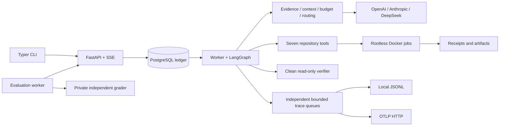

# Forge

**A coding-agent workbench that keeps code evidence current and makes execution recoverable.**

Forge accepts a repository, a fixed commit and a repair task. It produces a patch, an independent verification result, a replayable event stream and a model-usage ledger. The focus is the engineering between a model response and a trustworthy change: stale context, interrupted streams, ambiguous command outcomes, test tampering and uncertain spending.

This is a personal AI engineering project. It does not represent work performed at an employer. Offline scripts exercise the runtime; they are never presented as model repair performance.

## What is different

**Versioned evidence.** File observations carry their hash, line range and originating tool call. Test observations bind to a workspace snapshot and trusted verification profile. Before another model turn, Forge refreshes those references and withholds stale code from current context. Old artifacts remain readable. The `B2_guard_off` ablation tests whether the guard helps enough to justify its overhead; no improvement is assumed.

**Receipts before recovery.** A PostgreSQL model/tool ledger is separate from LangGraph checkpoints. Complete responses are reused after restart. Commands are named Docker jobs with durable receipts; patches have before/after manifests. A lost result becomes `needs_reconciliation`, never a blind command retry.

**Independent verification.** The model's `finish` call proposes a candidate. Verification applies the exported patch to a clean checkout, mounts it read-only, and requires a supported test runner's completion record, stable test identities and zero skipped tests. Regression-only results remain explicitly limited. Benchmark targets live outside the agent workspace.

## Architecture



- Python 3.13, `uv.lock`, FastAPI/Pydantic, Typer/Rich.
- OpenAI Responses, Anthropic Messages and DeepSeek Responses streams; explicit capabilities and native/portable continuation.
- SQLAlchemy/Alembic/PostgreSQL, fenced leases and monotonic persistent events; PostgreSQL LangGraph checkpoints.
- Rootless Docker, non-root task users, no network, read-only root filesystem, CPU/memory/PID limits.
- Ripgrep and tree-sitter Python symbols; structured compaction and bounded rule routing.
- Decimal reservations for every model attempt; partial usage retains budget occupancy.
- OpenTelemetry spans with independent bounded JSONL/OTLP export; JSONL/CSV/HTML evaluation output.

The product uses one coding agent per task. Independent planning, development and review agents were used to build it. See [design](docs/planning/architecture.md), [decisions](docs/adr/0001-single-agent-and-evidence.md) and [independent review](docs/reviews/independent-review.md).

## Run locally

The supported deployment is a trusted single user on Linux, with local repositories and prebuilt dependency images. Follow [the quickstart](docs/quickstart.md) for a complete public-API demonstration.

```bash
uv sync --frozen
cp .env.example .env
# Configure a random FORGE_API_TOKEN and allowed repository roots.
docker compose -f deploy/compose.yaml up -d --wait
uv run alembic upgrade head
bash scripts/rootless-daemon.sh
# Set FORGE_DOCKER_HOST to the endpoint printed above.
docker -H "$FORGE_DOCKER_HOST" build -f docker/runner.Dockerfile -t forge-runner:dev .
```

Run the API and worker in separate terminals:

```bash
uv run uvicorn forge.api.main:app --host 127.0.0.1 --port 8765
uv run forge-worker
```

Configure actual model IDs, capabilities and versioned prices in `configs/runs/`. Example live configurations intentionally require those values. Provider keys may be supplied through the worker's environment or local `.env`; they are excluded from run manifests and task containers. The server token is separate from provider credentials.

The CLI exposes `run`, `watch`, `approve`, `cancel`, `resume`, `diff` and `eval` through the public HTTP API. See [API and CLI reference](docs/api.md). A disconnected CLI does not stop a worker.

## Worker observability

Local JSONL and optional OTLP HTTP tracing use separate bounded SDK queues, so one exporter can fail or wait while the other continues. Each queue defaults to 256 spans with batches of up to 32. Span buffering is best effort: saturation can discard spans, and the PostgreSQL action/usage ledger remains the authority for recovery. [The environment example](.env.example) exposes queue, batch, scheduling, attribute and OTLP request-timeout settings.

To enable SDK queue-size and dropped-span measurements, export this flag in the worker's launching shell:

```bash
export OTEL_PYTHON_SDK_INTERNAL_METRICS_ENABLED=true
uv run forge-worker
```

Putting this SDK flag only in `.env` does not populate the process environment. Without it, queue/drop measurements are `null`, while Forge still counts export successes, failures and initialization failures. A successful exporter return is not proof of durable, exactly-once collector receipt. Graceful worker exit logs a `telemetry.closed` diagnostic snapshot after awaiting background shutdown. Shutdown is best effort; it does not forcibly terminate an arbitrary blocked exporter thread or promise a process-wide deadline.

Trace attributes are allowlisted and bounded; exception messages and stack traces are not automatically recorded. Two narrowly scoped, process-wide SDK logger filters sanitize OTLP diagnostics and suppress synchronous span queue warnings, whose losses are observable through the opt-in SDK metrics. Other application loggers are unchanged. [ADR 0007](docs/adr/0007-isolate-telemetry-export.md) records the filter boundary, failure behavior and decision to keep the tested dependency versions. See the dated [market and ecosystem review](docs/research/market-2026-09-13.md) and [validation record](docs/validation/telemetry-20260913/README.md) for the motivation, actual experiments and their limits.

## Validation and experiments

```bash
uv run ruff check src scripts tests examples migrations
uv run mypy src scripts/demo.py scripts/check_migration.py
uv run pytest -m 'not postgres and not docker and not live'
```

Ordinary CI does not call paid models. Rootless validation includes real OOM, process limits, CPU throttling, cancellation, worker death and read-only grader mounts. [Sandbox evidence](docs/validation/sandbox.md) records the actual daemon, image and test output. [Current status](docs/validation/current-status.md) separates tested behavior from remaining live measurements.

The diagnostic corpus contains 30 distinct defects with a frozen 10-development/20-heldout split. All original cases fail their independent targets; all reference patches pass targets and original regressions in rootless containers. [Qualification report](evals/reports/qualification/report.html) proves the dataset's checks, not an LLM's capabilities. Published source is diagnostic material, not a secret or industry-standard benchmark.

The harness supports B0/B1/B2/B3, a fixed strong-model comparator and the evidence-guard ablation, three repeats, task-paired analysis and a separately authorized experiment-wide cost ceiling. Private targets and reference patches are not published. [Evaluation guide](docs/evaluation.md) explains how to provision and run an experiment. The DeepSeek live pilot completed **72 trials on 12 tasks: 51 verified and 21 failed**. [Results and limitations](docs/validation/deepseek-live.md) explain the per-condition outcomes; [the machine status](evals/deepseek-live-status.json) preserves completion and unresolved accounting.

The [DeepSeek USD 10 pilot](docs/evaluation-deepseek.md) freezes 12 heldout tasks × 6 conditions × 1 repeat and two public smoke runs. Two documented development amendments retain failed smoke runs and bring the persistent campaign allocation to USD 9.44 across 76 slots under the original USD 10 authorization. Peak tariffs are reported as cost upper bounds; unknown usage remains reserved. Current Flash and Pro public smoke runs have independently verified. The 72 frozen heldout trials used the final 32K context / 24-attempt configuration; unsuccessful development runs remain in the accounting. The campaign conservatively accounts for **$1.630805844**, including $0.60 of full allocations for five unresolved runs. This is an upper-bound estimate plus reserves, not an exact invoice. B2 and its guard-off ablation both passed 10/12; no guard benefit is established by this pilot.

## Boundaries

- No claim of arbitrary shell exactly-once execution, deterministic model replay, production scale or measured model-quality improvements.
- Python test probes detect missing/skipped execution; they do not cryptographically secure an interpreter against code designed to attack the runner itself.
- Verified public acceptance uses unittest or pytest with completion evidence. An arbitrary command returning zero does not prove that tests ran.
- Cross-provider rebuilding preserves public facts and tool results, not opaque reasoning equivalence.
- Storage loss, distributed sandbox placement, public multi-tenancy, MCP, training and a web UI are outside the core scope.

See [implementation requirements](docs/planning/requirements.md) and [portfolio notes](docs/portfolio.md) for the engineering questions this project can substantiate.
